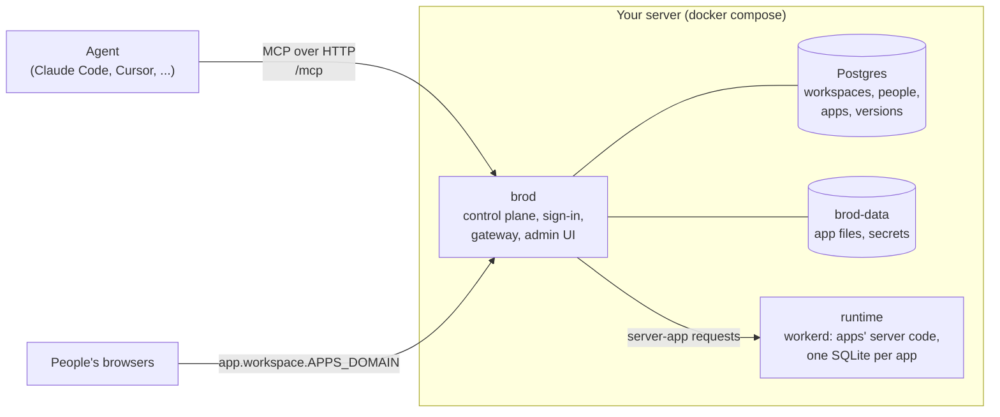

# Brod

**The self-hosted cloud your AI agent deploys team tools to, over MCP.**

[](https://github.com/brodsh/brod/actions/workflows/ci.yml)
[](LICENSE)


<sub>A real run: `docker compose up`, the first-start log, Claude Code deploying `examples/hello-team` over MCP, and the
app in a browser. The two waits are shortened; the whole run took about a minute.</sub>

Agents now build many small internal tools: an on-call rota, a stock checker, a form that replaces a spreadsheet.
Those tools need somewhere to live inside the company, behind the same sign-in, without each one having its own login,
user table and server. Brod is that place: your agent deploys to it directly over MCP and gets back an address that
only the right people can open.

## Quickstart

You need Docker with the Compose plugin.

```sh
git clone https://github.com/brodsh/brod && cd brod
cp .env.example .env        # then set BROD_ADMIN_EMAIL in .env
docker compose up -d
```

Then read the log:

```sh
docker compose logs brod
```

It ends with a one-time sign-in link. Open it: it signs you in and opens the agent connections page. Press **Make a
token** and copy it. It starts with `brod_` and is shown once.

**Claude Code**

```sh
claude mcp add --transport http brod http://localhost:8080/mcp --header "Authorization: Bearer brod_..."
```

**Claude Desktop**: Settings → Developer → Edit Config, then restart Claude Desktop.

```json
{
  "mcpServers": {
    "brod": {
      "command": "npx",
      "args": ["-y", "mcp-remote@0.14.3", "http://localhost:8080/mcp", "--header", "Authorization:Bearer ${BROD_TOKEN}"],
      "env": { "BROD_TOKEN": "brod_..." }
    }
  }
}
```

**Cursor**: `~/.cursor/mcp.json`

```json
{
  "mcpServers": {
    "brod": { "url": "http://localhost:8080/mcp", "headers": { "Authorization": "Bearer brod_..." } }
  }
}
```

Now ask your agent, from the cloned folder: *"Deploy examples/hello-team to Brod as On-call rota."* It answers with
the app's address. More clients and the OAuth sign-in are in [docs/mcp.md](docs/mcp.md).

## What you get

- **Workspaces.** One per team or company, each with its own people, groups and apps.
- **One sign-in for every app.** People sign in with an emailed link (or Google). Apps read who is signed in, with
  their role and groups, and keep no user table of their own ([the identity contract](docs/apps.md#the-identity-contract)).
- **Roles and access.** Workspace roles (admin, builder, member, guest) and per-app roles. Each app is private,
  shared with named people or groups, open to the workspace, behind a password, or public.
- **Deploys from any MCP agent.** 13 tools: deploy, read files back, logs, secrets, access, invitations, domains.
  Widening access and inviting people wait for a person to confirm.
- **Static and server apps.** Server code is a JavaScript `fetch` handler with its own SQLite database, key-value
  store and file storage.
- **Staging, publish and rollback.** Updates to a live app go to a staging address first. Publishing and rolling back
  move a pointer and take effect on the next request.
- **Working together.** Two agents changing the same app cannot silently overwrite each other's work.
- **Custom domains**, with HTTPS from Caddy or Brod itself.
- **Logs and analytics** per app, kept on your server, without cookies.
- **Secrets**, encrypted at rest and readable only by the app's server code.

## How it fits together



Brod decides who may open an app on every request, then serves its files or hands the request to the runtime. More in
[docs/architecture.md](docs/architecture.md).

## Self-hosted and brod.sh

Brod is one codebase. [brod.sh](https://brod.sh) runs the same image with `BROD_MODE=hosted`.

| | Self-hosted (this repository) | brod.sh |
| --- | --- | --- |
| Who runs it | You, on your machine or network | The Brod team |
| Plans and limits | None | Free, Solo and Team plans |
| Who creates workspaces | Your workspace admins | Anyone who signs up |
| Marketplace, abuse checks | Off unless you turn them on | On |
| Your data | On your server | On brod.sh's servers |
| Price | Free (AGPL-3.0) | See brod.sh |

## Documentation

- [Configuration](docs/configuration.md): every setting.
- [Running in production](docs/deploy-production.md): DNS, HTTPS, email, backups, upgrades.
- [Security](docs/security.md): what Brod protects against, and what it does not.
- [MCP](docs/mcp.md) · [Building apps](docs/apps.md) · [REST API](docs/api.md) · [Architecture](docs/architecture.md)

## Roadmap, contributing, license

- [Roadmap](docs/roadmap.md): what is not here yet, and what was left out on purpose.
- [Contributing](CONTRIBUTING.md): set up with `make dev`; `make check` before you push. Please follow the
  [code of conduct](CODE_OF_CONDUCT.md). Report vulnerabilities privately ([SECURITY.md](SECURITY.md)).
- License: [AGPL-3.0-only](LICENSE). You can run Brod inside your company and change it freely. If you offer a
  modified Brod to others as a network service, you must offer them its source.
