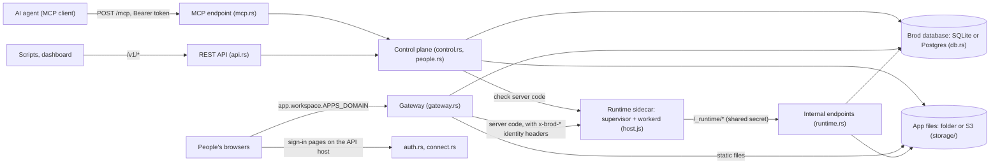
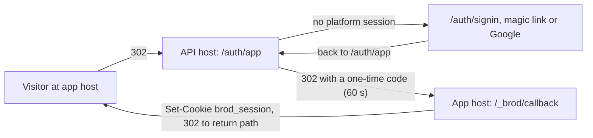

# Architecture

This page is for engineers who want to evaluate Brod or work on it. It describes what runs, how a request moves
through the server, where data lives, and what the isolation model does and does not give you. Every statement here
points at the code that implements it. When the code and this page disagree, the code is right and this page has a bug.

## 1. Overview

Brod is one Rust binary (`server/`, crate `brod`, binary `brod`). An AI agent connects to it over MCP at `/mcp` and
deploys a bundle of files. Brod stores the bundle as a numbered version and serves it at
`<app>.<workspace>.<APPS_DOMAIN>`. Every request to an app passes through Brod's gateway first. The gateway signs the
person in, decides whether they may open the app, and then serves static files from storage or forwards the request to
the app's server code. Server code runs in a separate sidecar: workerd running `deploy/runtime/host.js`, under a small
Rust supervisor. Brod keeps its own data in SQLite or Postgres and app files in a folder or an S3-compatible bucket.
One sign-in covers every app in a workspace.

## 2. Processes and containers

`docker-compose.yml` runs three containers. Two optional overlays add a fourth.

| Container | What runs | Listens on | Talks to |
|---|---|---|---|
| `brod` | `brod` (`server/src/main.rs`) | `BROD_LISTEN`, default `0.0.0.0:8080`. Compose publishes it on `127.0.0.1:8080` only. | Postgres over a Unix socket; the runtime at `BROD_RUNTIME_URL` (`http://runtime:8081`); the preview sidecar at `BROD_PREVIEW_URL`; S3, Resend or SMTP, Google, Stripe when configured. |
| `postgres` | Postgres 17 with `listen_addresses=` (no TCP) | Unix socket in the shared `postgres-socket` volume | Nothing. Brod connects as `postgres://brod@%2Fvar%2Frun%2Fpostgresql/brod` with `trust` auth. |
| `runtime` | `brod-runtime` (`deploy/runtime/supervisor/`) as PID 1 under `init`, which starts `workerd serve config.capnp` | workerd on `0.0.0.0:8081` (`deploy/runtime/config.capnp`) | Brod at `brod:8080` for code, secrets, files and logs. Apps' own `fetch()` goes to public addresses only. |
| `caddy` (optional, `deploy/compose.caddy.yml`) | Caddy 2 | 80, 443 (TCP and UDP) | Brod at `brod:8080`. Brod's port is then unpublished and `BROD_TRUST_PROXY=1`. |
| `preview` (optional, `deploy/compose.preview.yml`) | Node and headless Chromium (`deploy/preview/server.mjs`) | `0.0.0.0:8790` | Brod's internal listener. Only used when `BROD_MARKETPLACE` is on. |

Instead of Caddy, Brod can terminate TLS itself (`BROD_TLS=acme` or `local`, `server/src/tls.rs`,
`deploy/compose.tls.yml`). It then also listens on `BROD_HTTPS_LISTEN` (TLS, certificates on demand by SNI) and
`BROD_HTTP_LISTEN` (ACME HTTP-01 challenges and a redirect to HTTPS). The plain `BROD_LISTEN` listener keeps running for
the runtime and the preview sidecar.

### Internal endpoints and how they are protected

`server/src/http.rs` tags every request with the listener it came in on: `Via::Internal` (the plain `BROD_LISTEN`
listener) or `Via::Https` (Brod's own TLS listener). `app.rs::is_internal` accepts a request as internal only when it
came in on the plain listener **and** its Host is neither the API host nor under `APPS_DOMAIN`. The runtime and the
supervisor send `Host: brod:8080` or `Host: brod`, which passes. Requests Caddy forwards carry a public host, which
fails. `deploy/Caddyfile` also answers 404 for `/_caddy/*` and `/_runtime/*` as a second layer.

| Endpoint | Caller | Protection |
|---|---|---|
| `GET /_caddy/ask?domain=` | Caddy's on-demand TLS | Internal only. Answers 200 only for the API host, `www`, an existing workspace or app host, or a proven custom domain (`app.rs::may_have_certificate`). Brod's own TLS uses the same check. |
| `GET /_runtime/code?app=&version=` | host.js, on first load of an app version | Internal only, plus `x-brod-runtime-secret` compared in constant time (`runtime.rs::internal`). Returns the modules, decrypted secrets, settings and network declaration. |
| `POST /_runtime/logs`, `/_runtime/network`, `/_runtime/usage` | host.js | Same. |
| `GET/PUT/DELETE /_runtime/files/<app id>/<key>` | host.js (`env.FILES`) | Same. Keys with `.`, `..` or empty segments are refused. Writes count toward workspace storage. |
| `POST /_runtime/stopped` | the supervisor, before it restarts workerd | Same. Feeds `watchdog.rs`. |
| `http://<token>.brod-preview.internal` (any path) | the preview sidecar's Chromium | Only on `Via::Internal`. The token is 32 hex characters, names one listing release and expires after two minutes (`preview.rs`). |
| `/v1/admin/*` | the operator | Public, but needs `Authorization: Bearer <ADMIN_SECRET>` (`abuse.rs::serve`). |

The runtime exposes its own endpoints on port 8081: `/_runtime/check`, `/_runtime/wipe`, `/_runtime/sizes`,
`/_runtime/health`, and app requests. host.js refuses every request without the shared `BROD_RUNTIME_SECRET`
(`deploy/runtime/host.js`, default export). Brod sends that secret on every call to the runtime (`runtime.rs`,
`usage.rs`). host.js strips all `x-brod-runtime-*` headers before an app sees the request.

On a self-hosted server the runtime secret is generated with the other secrets, and Brod writes the value it uses to
`BROD_RUNTIME_SECRET_FILE`, or `<data>/runtime-secret` without it (`config.rs::from_env`). Compose points that at a
volume holding nothing else, `runtime-secret`, which the runtime container mounts read-only. The runtime never sees
Brod's data volume. The supervisor reads the secret from its own `BROD_RUNTIME_SECRET_FILE`
(`deploy/runtime/supervisor/src/main.rs::config`) and hands it to workerd.

### Background work in `brod`

`main.rs::run` starts three loops next to the listener: visit counts and analytics are flushed every 10 seconds
(`usage.rs`, `analytics.rs`); analytics older than the plan keeps are purged hourly; and, with a runtime, app database
sizes are fetched from `/_runtime/sizes` every 10 minutes. On SIGTERM it stops accepting, gives in-flight requests 10
seconds, and flushes counters once more.

The binary also has one-shot commands (`main.rs::main`): `healthcheck`, `migrate`, `setup-link`, `backup <file>`
(SQLite only, `VACUUM INTO`), and `migrate-to-postgres <sqlite-file> <postgres-url>` (`copy.rs`).

## 3. Request flow

### Splitting by host and path (`server/src/app.rs::handle`)

The order matters:

1. **Preview sandbox.** On the internal listener, a host `<token>.brod-preview.internal` goes to `preview::serve`.
2. **App hosts.** `app_labels` strips `.<APPS_DOMAIN>` from the host (unless the host is the API host itself) and
   checks that every label is `[a-z0-9-]`, at most 63 characters.
   - `[app, workspace]` goes to the gateway. `<app>--staging.<workspace>` is the app's staging address
     (`util.rs::STAGING_SUFFIX`).
   - `[www]` redirects to the API origin. `[workspace]` redirects to `/w/<workspace>` on the API host.
   - Anything else is a 404.
3. **Custom domains.** Any other host that is not the API host is looked up in `domains.rs::resolve_host`. A proven
   domain maps to one app, to a wildcard (`<app>.<domain>`), or to a workspace home page.
4. **HEAD on the API host** (except `/mcp`) is run as GET and the body is dropped (`without_body`).
5. **API host routes** (`api_host`). Any host that reaches this point is treated as the API host, including the
   internal `brod:8080`:
   - `/_caddy/ask` and `/_runtime/*`, internal only (see above).
   - `/mcp`: the MCP endpoint (`mcp.rs`). POST only. Stateless Streamable HTTP with JSON responses.
   - `/stripe/webhook`: hosted mode only (`billing.rs`).
   - `/v1/*`: the REST API (`api.rs`).
   - `/healthz`.
   - Everything else: first `connect.rs::serve` (OAuth metadata, `/oauth/*`, the connections page), then
     `auth.rs::serve` (sign-in, invitations, confirmations, workspace home and admin pages). Errors become an HTML page
     unless the request asked for JSON.

Every connection is served by hyper with HTTP/1.1 or HTTP/2 and a 30-second header read timeout
(`app.rs::serve_connection`). The scheme comes from the listener, or from `X-Forwarded-Proto` only when
`BROD_TRUST_PROXY=1` (`app.rs::request`).

### The gateway (`server/src/gateway.rs`)

`serve_app` wraps every app request so it is counted in analytics. `serve` then does this:

1. **Origin and cookie.** The origin is the app's address, its staging address, or the custom domain. The app session
   cookie `brod_session` is read for that origin, with the `__Host-` prefix on HTTPS (`util.rs::cookie`).
2. **One database trip.** The app row, the server-code and network columns of the version to serve
   (`live_version`, or `staging_version` on the staging address), the workspace slug, any takedown or suspension
   (`abuse.rs::hold_of`), the session user (`people::session_user`, which requires the session to belong to this app),
   and the access decision (`people::decide`).
3. **Staging rules.** On the staging address, `public`, `password` and `signed_in` are treated as `people`, and
   `admit_staging` lets in only the app owner, workspace admins and builders, and people granted the app's top role.
4. **Password mode.** `admit` lets a visitor with no grant in when they hold the `brod_pass` cookie, an HMAC of the app
   id and its current password hash. Changing the password ends every such cookie.
5. **`/_brod/*`** is handled by `special` (see below), before the rest.
6. **Method check.** A static app answers only GET and HEAD (405 otherwise).
7. **Access.** If the visitor is not allowed: the password page (401), a redirect to sign in, or, for a signed-in
   person the app was not shared with, the same 404 an empty address shows, plus a `refused` audit event.
8. **Paused** apps answer 503.
9. **Serving** (`serve_version`). Paths with `..` are refused. Files live at `<app id>/<version>/<path>`.
   - With server code: a GET for a file that exists in the bundle is served from storage (except `_worker.js` and
     `_worker/*`), `/` and `<path>/` as their `index.html`. Every other request goes to `runtime::dispatch`.
   - Static: the exact file, then `<path>/index.html`, then `<path>.html`, then the root `index.html` (single-page app
     fallback), then the bundle's `404.html`, then Brod's own 404 page.
10. **CSP.** `network::protect` adds a Content-Security-Policy built from the version's declared hosts. It is
    report-only when `BROD_NETWORK=log` (the default), enforced with `enforce`, and absent with `off`.

### Sign-in hand-off with a one-time code

Apps never see the platform session. The platform cookie `brod_platform` lives only on the API host. An app gets its
own session through a code (`auth.rs`, `/auth/app`; `gateway.rs`, `/_brod/callback`):

- `/auth/app` finds the app by `<slug>.<workspace>` (or `<slug>--staging.<workspace>`). For a custom domain it passes
  `host=` and gives a code only when `domains::allowed_host` confirms the domain belongs to that app.
- The code is 24 random bytes. Only its SHA-256 is stored in `app_codes`, with the app id, the user, the parent
  platform session and a 60-second expiry (`model.rs::limits::APP_CODE_TTL_MS`).
- `/_brod/callback` marks the code used and creates an app session in one `UPDATE ... RETURNING`. The session row
  records `app_id` and `parent`. It is valid only while the parent platform session is valid.
- `return` must be a path (`/x`, not `//x` or `/\x`), so the hand-off cannot redirect elsewhere.
- `/_brod/signout` revokes the parent session and every app session made from it (`people::revoke_session`).
- `/auth/app` hands out a code to any signed-in person. The access decision is made by the gateway on the next request.

### The `/_brod/` contract (`gateway.rs::special`)

| Path | What it does |
|---|---|
| `/_brod/me` | The signed-in person, their app role and groups, and a signed identity token. 401 when nobody allowed is signed in. |
| `/_brod/client.js` | A small `window.Brod` helper (`me`, `settings`, `signIn`, `signOut`). |
| `/_brod/signin`, `/_brod/callback`, `/_brod/signout` | The hand-off above. |
| `/_brod/password` | The password form for `password` mode. PBKDF2 runs on the blocking pool. 30 wrong tries per 15 minutes per app. |
| `/_brod/settings`, `/_brod/settings/<key>` | Workspace-chosen settings declared in the bundle's `brod.json` (`settings.rs`). |
| `/_brod/insights.js`, `/_brod/insights` | The analytics script and its beacon (`analytics.rs`). |
| `/_brod/csp` | CSP violation reports. Accepted from anyone and stored per app, at most 200 hosts (`network.rs`). |
| `/_brod/report` | Abuse report form. Only when `BROD_ABUSE_CHECKS` is on. |

### Forwarding to server code (`server/src/runtime.rs::dispatch`)

Request headers going to the runtime:

- Dropped: every `x-brod-*` header the visitor sent, `content-length`, hop-by-hop headers, and the app session cookie
  (`brod_session` and `__Host-brod_session`). Other cookies pass through.
- Added for a signed-in visitor: `x-brod-user-id`, `x-brod-user-email`, `x-brod-user-name` (URI-encoded),
  `x-brod-role`, `x-brod-groups` (comma-separated), and `x-brod-identity`, a token signed with HMAC-SHA256 under a
  per-app key derived from `IDENTITY_SECRET` (`gateway.rs::identity_for`, 300-second lifetime).
- Added for the runtime only, stripped by host.js: `x-brod-runtime-secret`, `-app`, `-version`, `-rev` (secrets
  revision), and `-url` (the URL the app sees).

Response handling:

- `x-brod-app` and `x-brod-version` are set by Brod and replace any the app sent.
- For any app that is not `public`, `cache-control` becomes `private, no-cache` unless the app already said `private`
  or `no-store`, and `vary: cookie` is added.
- A `public` app's HTML response is buffered (up to 20 MB) and the report link is appended before `</body>`.
- Other responses stream. The watchdog ticket stays open until the body is done, so a stall mid-stream is still
  attributed to the app.
- While workerd restarts, a request without a body is retried for up to 10 seconds if it never reached the runtime.

For static HTML (`gateway.rs::file_response`), Brod injects the insights script (`with_insights`) unless the page
already loads it or opts out with `<meta name="brod-insights" content="off">`. On a `public` app, with abuse checks on,
it also appends the report link. Static responses carry an ETag, `no-cache` (so a rollback shows on the next request),
`x-content-type-options: nosniff`, and `x-robots-tag: noindex` on non-public HTML.

## 4. Deploy flow

Agents call the MCP tool `deploy_app` (`mcp.rs`). Scripts and the dashboard use `/v1/` (`api.rs`). Both call
`control.rs::deploy`. Small bundles (up to 1 MB, `limits::INLINE_BYTES`) come inline. For larger ones, `deploy_app`
without files returns a one-time upload address (`control::create_upload`). The agent PUTs a `.tar.gz` to
`/v1/uploads/<id>`. The upload address is its own credential and expires after 15 minutes.

Steps in `control::deploy`:

1. **Caller checks.** Workspace role `builder` or higher, at most 30 deploys per workspace per hour (staging deploys
   count), and the workspace and app are not suspended or taken down (`abuse.rs`).
2. **Unpack and clean.** `tar.rs` reads `.tar`, `.tar.gz` and `.zip` in memory. `control::normalise` drops junk
   (`.DS_Store`, `__MACOSX/`, `.git/`), strips one wrapping folder such as `dist/`, and refuses `..`, paths over 400
   characters and anything under `_brod/`. Limits (`tar.rs`): 25 MB archive, 60 MB unpacked, 10 MB per file, 2000
   files.
3. **Server code.** `runtime::find_server` looks for `_worker.js` or `_worker/index.js` (or `index.mjs`).
   `runtime::check_server` sends the modules to the runtime's `/_runtime/check`. host.js loads them in a throwaway
   isolate with no network (`globalOutbound: null`), runs the top-level code, and checks that the default export has
   a `fetch` method. Without a runtime, server code is refused with `server_apps_unavailable`.
4. **`brod.json`.** Settings (`settings.rs`) and the outbound host list (`network.rs`) are parsed and kept with the
   version.
5. **Phishing scan.** Only with `BROD_ABUSE_CHECKS` (`scan.rs`). A flagged version still deploys, but an automatic
   report is filed and a live app is narrowed so it is not open beyond named people (`abuse::narrow_if_flagged`).
6. **Storage quota and target.** `usage::check_storage`, then the app is found by slug or created (new apps start
   `private` with roles `owner, editor, viewer`).
7. **Base version check.** If `base_version` is given and is not the app's current version (staging if any, else live),
   the deploy is refused with `409 stale_base` and a list of who deployed what since.
8. **Version number.** `UPDATE apps SET last_version = last_version + 1 ... RETURNING`, so two concurrent deploys
   never share a number.
9. **Files.** Written to `<app id>/<n>/<path>`, 20 at a time. Nothing is visible yet.
10. **Pointer move**, in one transaction: insert the `versions` row, check `base_version` again, then set
    `staging_version` or `live_version`. If anything fails after the files were written, the `<app id>/<n>/` prefix is
    deleted.

Live and staging:

- An agent updating an app that already has a live version deploys to staging, unless it passes
  `environment: "production"`. A person, or a first version, goes live unless staging is asked for
  (`control::deploy_to_staging`).
- `publish_staging` moves the staging pointer to live in one conditional `UPDATE`. `discard_staging` clears it and keeps
  the version.
- `rollback` sets `live_version` to an existing version. Nothing is rebuilt or copied. The phishing flag of the target
  version is applied again.
- `delete_version` refuses the live and staging versions.

`get_files` returns an app's current files (inline when small, otherwise a short-lived `.tar.gz` download address) and
records that the caller is working on the app (`editing` table). Deploys return a warning when others touched the app
in the last two hours. Nothing is locked.

## 5. Data

### Brod's own database (`server/src/db.rs`)

- **SQLite** at `<BROD_DATA_DIR>/brod.db` by default: WAL mode, `synchronous = NORMAL`, foreign keys on, a pool of
  `BROD_DB_CONNECTIONS` (default 8). Write transactions use `BEGIN IMMEDIATE`.
- **Postgres** when `BROD_DATABASE_URL` is set. Every write transaction (`db::tx`) takes the same advisory lock
  (`pg_advisory_xact_lock`), so writers run one at a time, as on SQLite.
- Domain code writes SQLite's dialect only. `db::pg_sql` translates each statement once for Postgres: `?` and `?N`
  placeholders, `IS ?` to `IS NOT DISTINCT FROM`, `INSERT OR IGNORE` to `ON CONFLICT DO NOTHING`, and two-argument
  `MAX`/`MIN` to `GREATEST`/`LEAST`.
- All database calls run on tokio's blocking pool (`Db::call`).
- **Migrations** are `migrations/*.sql` (SQLite) and `migrations-pg/*.sql` (Postgres), with the same file names,
  embedded in the binary with `include_str!`. `db::migrate` applies pending ones at start, each in its own transaction,
  and records them by name in a table called `d1_migrations`, a name kept for historical reasons. On
  Postgres a separate advisory lock stops two servers from migrating at once. With `BROD_AUTO_MIGRATE=false`, Brod refuses to start while migrations are pending, and `brod migrate` applies them.

Main tables: `users`, `sessions` (platform and app sessions), `workspaces`, `members`, `groups`, `group_members`,
`spaces`, `space_members`, `invites`, `apps`, `versions`, `grants`, `secrets`, `tokens`, `oauth_clients`,
`oauth_codes`, `app_codes`, `login_links`, `confirmations`, `uploads`, `downloads`, `editing`, `events` (audit log),
`app_logs` (server-app logs, kept 7 days), `domains`, `network_reports`, `app_settings`, analytics tables
(`visits`, `page_views`, `app_events`, `request_stats`), and the marketplace and abuse tables.

### App files (`server/src/storage/`)

One interface (`put`, `get`, `head`, `list`, `delete`) over two backends:

- `storage/fs.rs`: a folder (`FILES_DIR`, default `<data>/files`), the object under `objects/<key>` and its metadata
  under `meta/<key>.json`.
- `storage/s3.rs`: any S3-compatible bucket, with SigV4 signing written out in the module.

Key layout:

| Key | Content |
|---|---|
| `<app id>/<version>/<path>` | A version's bundle files. Never changed after the deploy. |
| `<app id>/files/<key>` | Files the app's server code stored through `env.FILES`. Shared by all versions. |
| `<listing id>/<n>/<path>` | Marketplace releases (`market.rs`). |

### Per-app databases in the runtime

Each server app gets one SQLite database and a small key-value store: a Durable Object named by the app id, stored on
the runtime's disk (`/data`, the `runtime-data` volume). host.js exposes it as `env.DB` (`query`, `run`, `batch`) and
`env.KV` (string values up to 128 KB). The object reports its size to Brod after writes (`/_runtime/usage`). While the
workspace is out of storage, writes that can grow it are refused. Deleting an app wipes its object
(`runtime::wipe_app_data`).

The app's database is keyed by app id only, not by version. Staging, live and every rolled-back version share it.

Backups: `brod backup` and `pg_dump` cover Brod's database only. App files are in the files folder or bucket. App
databases are in the runtime's volume. An operator must back up all three.

### Secrets (`server/src/secrets.rs`)

App secrets are encrypted with AES-256-GCM. The key is derived from `SECRETS_KEY` with HKDF-SHA256 (info
`"brod app secrets v1"`). The app id is the associated data, so a sealed value copied to another app does not decrypt.
Stored as `base64(iv).base64(ciphertext+tag)`. Names are `UPPER_SNAKE_CASE`; `DB`, `KV`, `FILES`, `SETTINGS` and
`BROD_*` are reserved. At most 50 secrets of 5 KB each per app. Nobody can read a secret back through the API. The
runtime gets them decrypted from `/_runtime/code` and passes them to the app as `env.<NAME>`. Changing a secret bumps
`apps.secrets_rev`, which is part of the isolate cache key, so the next request loads a fresh isolate.

### Generated server secrets (`server/src/config.rs`)

In self-hosted mode, any of `ADMIN_SECRET`, `IDENTITY_SECRET`, `SECRETS_KEY` and `BROD_RUNTIME_SECRET` that is not set
is generated (32 random bytes, hex) and kept in `<data>/secrets.env`, mode 0600. The runtime secret is also written to
`BROD_RUNTIME_SECRET_FILE` (in Compose, the `runtime-secret` volume) for the runtime container. Back up `secrets.env` with the database: without `SECRETS_KEY`, app
secrets cannot be decrypted, and without `IDENTITY_SECRET` all password cookies and identity tokens change. In hosted
mode every secret must come from the environment, and weak values (under 32 characters or known examples) stop the
server from starting.

## 6. Auth

### Two kinds of session

| | Platform session | App session |
|---|---|---|
| Cookie | `brod_platform` on the API host | `brod_session` on one app host or custom domain |
| Created by | magic link or Google sign-in (`auth.rs`) | `/_brod/callback` (`gateway.rs`) |
| Row in `sessions` | `app_id` NULL | `app_id` set, `parent` = platform session hash |
| Lifetime | 30 days (`limits::SESSION_TTL_MS`) | 30 days, and only while the parent is valid |

Session tokens are 24 random bytes in hex. Only their SHA-256 is stored. Cookies are `HttpOnly; SameSite=Lax;
Path=/`, plus `Secure` and the `__Host-` prefix when the origin is HTTPS (`util.rs::set_cookie`). With `__Host-`, an app
on a sibling host cannot plant a cookie Brod would read. On plain HTTP there is no prefix and no such protection.

Forms on the API host check that `Origin` equals the API origin (`auth.rs::same_origin`). Cookie-authenticated `/v1`
and `/mcp` requests that change something need the same `Origin` (`control::check_origin`).

### Magic links

`POST /auth/start` stores the SHA-256 of a 24-byte token in `login_links`, valid 15 minutes, and emails the link
(`email.rs`: Resend, SMTP, or the server log when self-hosted with neither). Limits: 5 links per address per hour, 20
per client IP per hour. `GET /auth/verify` only shows a button, so a mail scanner that follows the link does not use it.
`POST /auth/verify` marks the link used and signs the person in. With `DEV_MODE=1`, the link is also returned in the
API response.

### Google

`/auth/google` stores a random `state` in `login_links` (with an empty email) and redirects to Google.
`/auth/google/callback` consumes the state, swaps the code at Google's token endpoint, and accepts the ID token's
claims when `aud` is the client id, `iss` is Google, and `email_verified` is true. The token's signature is not
checked, because it came straight from Google's token endpoint over TLS.

### OAuth 2.1 for MCP clients (`server/src/connect.rs`)

- `/mcp` answers 401 with `WWW-Authenticate: Bearer resource_metadata=".../.well-known/oauth-protected-resource/mcp"`.
- `/.well-known/oauth-authorization-server` advertises the endpoints, `S256` only, public clients only
  (`token_endpoint_auth_methods_supported: ["none"]`), and scopes `brod` and `brod:read`.
- `/oauth/register` is dynamic client registration (RFC 7591), rate-limited per IP. Redirect URIs must be `https`,
  `http` on a loopback host, or a custom scheme not on a block list (`javascript`, `data`, `file`, ...). Loopback
  redirects may differ by port (RFC 8252).
- `/oauth/authorize` requires PKCE with `S256`. The person signs in, picks a workspace, and must be a builder or
  admin there. Codes live 10 minutes and are single use.
- `/oauth/token` returns an access token (`brod_...`, one hour) and a refresh token (`brodr_...`, lapses after 30 days
  unused). Each refresh rotates both. If the previous refresh token is sent again, the whole connection is revoked
  (`control::refresh_oauth_token`). A refresh may narrow `brod` to `brod:read`, never widen.

### Personal access tokens

Made on `/w/<workspace>/connections` by a builder or admin, never by an agent (`control::create_token`). Format
`brod_` plus 24 random bytes in hex. Only the SHA-256 is stored. Optional expiry of 1 to 365 days. Scope `manage` or
`read`; a read-only connection can call GET routes and read-only tools only (`control::require_write`). OAuth access
tokens live in the same `tokens` table and are listed and revoked the same way. A token stops working when its creator
is removed from the workspace or becomes a guest (`control::authenticate`).

### Roles

Workspace roles (`model.rs::rank`, `people.rs`): `admin` > `builder` > `member` > `guest`. Builders deploy and manage
apps; admins also manage people, groups and spaces. Guests are not counted as "everyone in the workspace".

App roles are a per-app list, default `owner, editor, viewer`; the first is the top role. `people::decide`:

- The app's owner and workspace admins get the top role.
- Otherwise the best matching grant wins. Grant subjects are `user:<id>`, `group:<id>`, `domain:<email domain>`,
  `workspace` and `signed_in`. Members of the app's space count as named on it (`spaces.rs`).
- Access modes (`model.rs::ACCESS`, from narrowest to widest): `private` (owner and admins), `people` (named grants),
  `workspace` (non-guest members, or named grants), `password` (named grants, or anyone with the password),
  `signed_in` (anyone signed in to this Brod server, in any workspace), `public` (anyone, no sign-in).

Apps read the result from `/_brod/me` or the `x-brod-*` headers. Brod does not enforce app roles inside the app; the
app must.

### Confirmations for agent actions

When an agent (token caller) asks for something that widens access, nothing changes. Brod stores a `confirmations` row
and returns a `confirm_url` (`control::needs_confirmation`, 24-hour expiry). This applies to:

- `set_access` that moves to a wider mode, adds grants, or sets a new password (`control::set_access`);
- `invite` (`control::invite_from`);
- deleting an app (`control::delete_app`).

A person opens `/confirm/<id>`, signs in, and confirms with a same-origin POST. The change then runs as that person, so
it needs their role (`control::confirm`). Narrowing access, deploying (including straight to production), setting
secrets and rolling back do not need confirmation.

## 7. Modes

`BROD_MODE` is `self-hosted` (default) or `hosted` (`config.rs`). Related switches default from it.

| Area | Self-hosted | Hosted | Code |
|---|---|---|---|
| Secrets | Generated into `<data>/secrets.env` if unset; weak ones only warn | Must be set; weak ones refuse to start (unless `DEV_MODE=1`) | `config.rs` |
| `BROD_PUBLIC_URL` / `APPS_DOMAIN` | Default `http://localhost:<port>`; apps under the same host | Required | `config.rs` |
| Plans and limits | No plans: unlimited apps, members, storage; 365 days of analytics | free / solo / team limits | `model.rs::plan_named` |
| Billing | Off; `/stripe/webhook` and `/v1/billing` not routed | Stripe, when configured | `app.rs`, `api.rs`, `billing.rs` |
| Creating workspaces | Admins of an existing workspace, or on an empty server `BROD_ADMIN_EMAIL` (anyone who signs in first, if unset) | Anyone with a verified email; must accept terms | `people.rs::may_create_workspace`, `create_workspace` |
| First start | Creates `BROD_ADMIN_EMAIL`'s "Default" workspace and prints a sign-in link | Nothing | `setup.rs` |
| `/` | Sign-in form | Landing page (`home.rs`), `/terms`, `/auth/signup` | `auth.rs` |
| Email | Falls back to printing messages in the log | Refuses to send without Resend or SMTP | `email.rs` |
| Marketplace (`BROD_MARKETPLACE`) | Off by default | On by default | `api.rs`, `market.rs` |
| Abuse checks (`BROD_ABUSE_CHECKS`): phishing scan, report link, new-workspace hold | Off by default | On by default | `scan.rs`, `abuse.rs`, `gateway.rs` |

## 8. Isolation model and its limits

Brod is built for a team that trusts its own builders and agents more than it trusts the internet. It is **not** a
sandbox for hostile code. Read this section before you let people you do not trust deploy to your server.

### What server code runs in

- All server apps run in **one workerd process**. Each app version gets its own V8 isolate through the Worker Loader,
  keyed by `<app id>:<version>:<secrets revision>` (`host.js::serverFor`). Isolates separate memory and globals. They
  are not separate processes, and V8 is the only boundary between apps.
- An app's `env` holds only its own secrets, settings and the `DB`, `KV` and `FILES` bindings, each scoped to its app
  id by `props` set by host.js. An app cannot name another app's database or files through these bindings.
- Open-source workerd runs every isolate on one thread and does not enforce the CPU limit host.js asks for
  (`cpuMs: 50`). One app in a tight loop stops every server app. One app that runs out of heap aborts the whole process.
- The **supervisor** (`deploy/runtime/supervisor/src/main.rs`) polls `/_runtime/health` every 500 ms and reads
  workerd's RSS. When workerd does not answer for `RUNTIME_STALL_MS` (default 5000), uses more than `RUNTIME_MEMORY_MB`
  (default 1536), or exits, it tells Brod (`/_runtime/stopped`), kills workerd and starts it again with backoff.
  Every in-flight request of every app is lost.
- **Blame** is worked out in Brod (`watchdog.rs`) from the requests it had in flight. A sole suspect is stopped for 1,
  then 5, then 30 minutes; with several suspects, each gets a strike and is stopped after three in ten minutes. This
  state is in memory and is lost when Brod restarts. Static files of a stopped app keep serving.
- Compose sets a kernel memory ceiling on the runtime container (`mem_limit`, default 2g).

### Outbound network

- In workerd, apps' own `fetch()` goes through `AppOutbound` (`host.js`). Hosts declared in `brod.json` pass. Other
  hosts are reported to Brod, and refused only when `BROD_NETWORK=enforce`. The default is `log`, which lets them
  through.
- Beneath that, workerd's `internet` service allows public addresses and denies private and local ones
  (`config.capnp`). This is what keeps app code away from Brod, Postgres and the runtime's own ports.
- In the browser, the CSP from `network::csp` limits `connect-src`, `img-src`, `script-src`, `frame-src`,
  `form-action` and others to `'self'` and the declared hosts. It allows `'unsafe-inline'` and `'unsafe-eval'`
  scripts. It is report-only by default. It does not restrict top-level navigation or `window.open`, and it sets no
  `frame-ancestors`, so any site can frame an app.
- This policy helps an honest maker find undeclared calls and gives an operator a record. It is not a guarantee that
  data cannot leave.

### Browser origins

- Each app has its own host, so it has its own origin, cookies and storage. Cookies are host-only and, on HTTPS,
  `__Host-` prefixed, so one app cannot read or overwrite another app's session or the platform session.
- All apps under one `APPS_DOMAIN` share a registrable domain, so they are **same-site** with each other.
  `SameSite=Lax` does not stop app A's page from sending a POST, with the visitor's cookie, to app B. Server apps that
  change data on POST should check `Origin` themselves. The enforced CSP's `form-action` and `connect-src` help only
  under `BROD_NETWORK=enforce`.
- On plain HTTP there is no `__Host-` prefix. An app can set a cookie with a `Domain` attribute that covers its
  siblings, or the API host when `APPS_DOMAIN` defaults to it. Run anything beyond a local trial on HTTPS, with
  `APPS_DOMAIN` separate from the API host.

### Staging

The staging address serves a different version with the same app id. It shares the live app's database, key-value
store, files and secrets. A staging version that migrates or deletes data does it to live data.

### What an operator must not assume

- That workerd isolates protect the host from a V8 escape. The runtime container mounts Brod's data volume read-only
  (`docker-compose.yml`), which contains `secrets.env` and, with SQLite, the database. A process escape there reaches
  all of it.
- That one app cannot slow down or crash the others. It can, until the supervisor restarts workerd.
- That the outbound policy stops data exfiltration. In `log` mode it records; in `enforce` mode it covers `fetch()`
  from server code and most browser loads, not navigation.
- That the phishing scan catches phishing. It is a heuristic over HTML and JavaScript, off by default when self-hosted.
- That the gateway enforces app roles. It decides who may open an app and passes the role on. The app enforces what
  each role may do.
- That `signed_in` means "my team". It means anyone with an account on this Brod server.
- That staging is isolated from production data.
- That a confirmation is needed for every risky agent action. Deploys to production, secrets and rollbacks are not
  confirmed.

### Errors and logs

One error type covers everything a request can fail with: `Problem` (`problem.rs`), with an HTTP status, a stable
`code` an agent can branch on (`stale_base`, `workspaces_closed`, ...), a message a person can act on, and optional
extra fields. Anything unexpected becomes `Problem::internal`, which logs the detail and answers a 500 with no detail.
Configuration has its own `ConfigError`, which names variables but never their values. Brod is one binary, not a set of
libraries, so there is no `anyhow`/`thiserror` split; `?` carries a `Problem` from the database layer to the response.

Logs are `tracing` events on stdout (`BROD_LOG`, `BROD_LOG_FORMAT=json`). The first-start banner and emails printed in
log mode are plain text on purpose: people copy from them.

## 9. Code map

`server/src/`:

| Module | Purpose |
|---|---|
| `main.rs` | Entry point: one-shot commands, listener, background loops, graceful shutdown. |
| `lib.rs` | Module list. |
| `app.rs` | Splits requests by host and path; `/_caddy/ask`; hyper connection setup. |
| `http.rs` | The `Req` type, listener tag (`Via`), response helpers and platform pages. |
| `gateway.rs` | App requests: access, sign-in hand-off, `/_brod/*`, static files, insights and report-link injection. |
| `people.rs` | Users, sessions, workspaces, members, groups, invites, grants, and the access decision. |
| `auth.rs` | API-host pages: magic links, Google, `/auth/app`, invitations, confirmations, workspace home. |
| `connect.rs` | OAuth 2.1 for MCP clients and the connections page. |
| `mcp.rs` | The MCP endpoint and its tools. |
| `api.rs` | The REST API under `/v1/`. |
| `control.rs` | The control plane: authentication, tokens, deploy, staging, rollback, access, confirmations. |
| `tar.rs` | Unpacks `.tar`, `.tar.gz` and `.zip`; packs `.tar.gz`. |
| `runtime.rs` | Server-code check, dispatch to the runtime, and the `/_runtime/*` endpoints. |
| `watchdog.rs` | Tracks requests in flight to the runtime and stops apps that stall or crash it. |
| `network.rs` | Outbound host declarations, CSP, and undeclared-host reports. |
| `secrets.rs` | AES-256-GCM encryption of app secrets. |
| `settings.rs` | Per-app settings declared in `brod.json`. |
| `db.rs` | SQLite and Postgres behind one SQLite-dialect interface; migrations; backup. |
| `copy.rs` | `brod migrate-to-postgres`. |
| `storage/mod.rs`, `fs.rs`, `s3.rs` | App file storage in a folder or an S3-compatible bucket. |
| `config.rs` | Configuration from the environment; generated secrets. |
| `setup.rs` | First-start admin, workspace and sign-in link. |
| `email.rs` | Email through Resend, SMTP or the log. |
| `tls.rs` | Brod's own HTTPS with on-demand ACME certificates. |
| `domains.rs` | Custom domains and their TXT-record proof. |
| `spaces.rs` | Spaces: groups of apps and people inside a workspace. |
| `usage.rs` | Visit counts and storage accounting. |
| `analytics.rs` | Page views, browser events and request counters; the insights script. |
| `abuse.rs` | Rate limits, takedowns, suspensions, the operator API `/v1/admin`. |
| `scan.rs` | Deploy-time phishing heuristic. |
| `market.rs` | The marketplace: listings, releases, installs. |
| `preview.rs` | Marketplace preview sandboxes for the preview sidecar. |
| `billing.rs` | Stripe plans and webhook (hosted). |
| `admin.rs`, `admin.html` | The workspace admin page. |
| `home.rs`, `home.html` | The hosted landing page. |
| `model.rs` | Shared types, plans and limits. |
| `problem.rs` | The error type and its JSON shape. |
| `state.rs` | Shared state built at start. |
| `util.rs` | Ids, hashing, signing, cookies, URI encoding, slugs. |

Outside `server/`:

| Path | Purpose |
|---|---|
| `deploy/runtime/host.js` | The workerd host Worker: loads apps, `env.DB`/`KV`/`FILES`, outbound gate, logs. |
| `deploy/runtime/config.capnp` | workerd services, sockets, bindings and network rules. |
| `deploy/runtime/supervisor/` | `brod-runtime`: starts and restarts workerd. |
| `deploy/preview/` | Headless Chromium preview service and its address guard. |
| `deploy/Caddyfile`, `deploy/compose.*.yml` | Caddy, Brod-TLS and preview overlays. |
| `scripts/e2e-rust.mjs` | Builds and starts Brod, then runs the end-to-end suites below. |
| `scripts/e2e.mjs` | Core suite over MCP (official client) and REST. |
| `scripts/e2e-billing.mjs`, `e2e-market.mjs`, `e2e-tokens.mjs`, `e2e-server-apps.mjs` | Billing and storage, marketplace, connection tokens, server apps on workerd. |
| `scripts/e2e-self-hosted.mjs` | Quickstart defaults: no secrets, no email, first-start link. |
| `scripts/e2e-tls.mjs` | Brod's own HTTPS against Pebble. |
| `scripts/fake-s3.mjs`, `fake-dns.mjs`, `fake-stripe.mjs` | Stand-ins used by the suites. |

## 10. Testing

**Unit tests.** `cargo test --manifest-path server/Cargo.toml` and the same for `deploy/runtime/supervisor/`. Database
tests use a temporary SQLite file, or Postgres when `BROD_TEST_DATABASE_URL` is set (`db.rs::test_db`). The
SQLite-to-Postgres copy test needs Postgres (`copy.rs`). `npm test` runs vitest over the preview service's address
guard (`test/preview-guard.test.ts`).

**End-to-end.** `scripts/e2e-rust.mjs` builds the release binary (unless `BROD_BIN` is set), starts it with
`DEV_MODE=1` and `BROD_MODE=hosted` on a fresh data directory, starts the runtime under its supervisor, then runs
`e2e.mjs`, `e2e-billing.mjs`, `e2e-market.mjs`, `e2e-tokens.mjs` and, with a runtime, `e2e-server-apps.mjs`.
Modes combine:

| Command | What changes |
|---|---|
| `npm run e2e:rust` | Files in a folder, server apps on workerd. |
| `npm run e2e:rust:s3` (`s3`) | Files in a fake S3 server that checks every SigV4 signature. |
| `npm run e2e:rust:static` (`static`) | No runtime: server code must be refused. |
| `npm run e2e:rust:pg` (`pg`) | Database in a fresh Postgres database at `E2E_DATABASE_URL`. |
| `npm run e2e:self-hosted` | Self-hosted defaults: only `BROD_ADMIN_EMAIL`, follows the link from the log, deploys over MCP, restarts. |
| `npm run e2e:tls` | `BROD_TLS=acme` against Pebble with real HTTP-01 challenges, custom domains included. |

Set `E2E_SKIP_PREVIEWS=1` to run without Chromium.

**Compose smoke test.** `deploy/smoke-test.sh` starts Brod, Postgres, the runtime and Caddy (with Caddy's local CA) as
the `brodsmoke` project and checks HTTPS end to end. Build the images first with `docker compose build`.

**CI** (`.github/workflows/ci.yml`), on every push and pull request:

- `node`: `npm test`.
- `secrets`: gitleaks over the history and the working tree.
- `dependencies`: `cargo deny` and `cargo audit` for both Rust crates, and `npm audit`.
- `rust`: `cargo fmt --check`, `cargo clippy -D warnings`, unit tests; `e2e:rust`, `e2e:self-hosted`,
  `e2e:rust:static`, `e2e:rust:s3`, `e2e:tls`; Docker image builds; `docker compose config` for every overlay; the
  quickstart (`docker compose up -d --wait`, sign-in link in the log, `/healthz`); and `deploy/smoke-test.sh`.
- `rust-postgres`: unit tests with `BROD_TEST_DATABASE_URL`, `e2e:rust:pg`, and `e2e-rust.mjs pg s3 static`.
